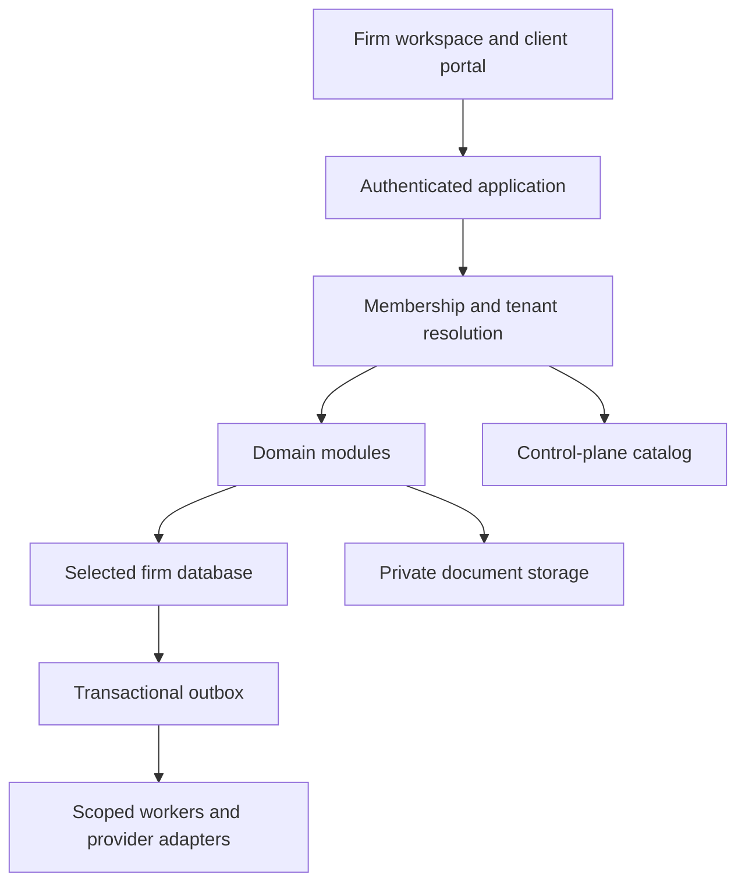

# Application architecture

[Home](../README.md) · [Codebase audit](current-codebase-audit.md) · [Stack and runtime](stack-and-runtime.md) · [Solution structure](solution-structure.md) · [Module sweep (2026-10-13)](module-interaction-and-vulnerability-sweep-2026-10-13.md) · [Standards comparison (2026-10-13)](architecture-standards-comparison-2026-10-13.md) · [Tenancy ADR](../database/ADR-001-tenancy.md) · [Integrations](../integrations/README.md)

## Audited starting point
The repository was audited on 2026-10-12 ([findings](current-codebase-audit.md)). It is a .NET 8 minimal-API backend with EF Core on MySQL and a React/Vite SPA, and that stack is kept ([rationale](stack-and-runtime.md)). Feature code is already organized as modules (`backend/Features/<Module>/<Module>Endpoints.cs` implementing `IEndpointModule`), all sharing one `LawFirmDbContext`. That is a reasonable modular-monolith seed. Endpoints currently query the context directly with inline DTO projection. Keep that convention, but move authorization filtering (matter grants, audience) into shared query helpers so it cannot be forgotten per endpoint. Matter and party filtering moved into `Infrastructure/Access` in slice F1.

## Folder conventions
The backend and frontend folder layout, the research behind it, and the steps for adding a module are in [solution and folder structure](solution-structure.md) (slice R1). In short: one API project organized by feature folders with `Contracts/` per module and entities under `Infrastructure/Persistence/Entities/`; root build files (`MatterForge.sln`, `Directory.Build.props`, `Directory.Packages.props`, `global.json`); separate unit and integration test projects; and a feature-based React `src/` with an `index.ts` public API per feature. The planned modules (documents, engagements, billing, payments, trust, communications) and provider interfaces (tenancy, outbox, storage, email, payments, e-signature) exist as **not implemented** boilerplate.

## Proposed shape
A modular monolith with boundaries for identity/access, intake, matters, portal publishing, documents/evidence, calendaring, communications, billing/trust, practice extensions, and integration adapters. Modules own their writes. Services may use a single transaction within a tenant database. Durable outbox events coordinate external work; do not require a successful provider call inside a database transaction.

Control plane stores tenant routing, domains, platform identity references, memberships, subscriptions, and provisioning status. It should not store confidential legal narratives. Data plane stores each firm's legal and financial records. Object storage is private and scoped independently of SQL isolation.

## Request boundary
Authenticate → resolve trusted firm context → verify active membership → enforce role/matter/audience permissions → access the selected tenant repository → serialize an allowed DTO → audit sensitive action. A hostname selects a candidate firm, not permission. Tenant identifiers in payloads are never authoritative.

Background jobs, cache keys, full-text search, exports, scheduled tasks, telemetry, and provider credentials must carry firm scope. Clear scoped context between jobs and on pooled connections. Platform administrators must not become implicit legal superusers.

## API and consistency
Version external contracts; validate server-side; use concurrency tokens for contested changes. Paginate matter lists and search results. Use deterministic idempotency for payments, signatures, imports, and webhook processing. Request IDs are for tracing, not authorization. Distinguish pending work from failure. Explicitly document which changes become visible immediately and which are eventual.

## Docker profile rollout verification

### Validation performed

- `docker compose config` ✅
- `docker compose --profile dev config` ✅
- `docker compose --profile prod config` ✅
- `docker compose --profile dev up -d --build` ✅
- `docker compose --profile dev ps` shows:
  - `backend-dev` healthy
  - `mysql` healthy
  - `frontend` running
  - `migrate` exited `0`
- `curl http://localhost:8080/up` returns HTTP `200` ✅
- Lint diagnostics on changed files: no errors ✅

### New run commands

- **Dev stack:** `docker compose --profile dev up -d --build`
- **Prod-style backend stack:** `docker compose --profile prod up -d --build`
- **Stop stacks:**
  - `docker compose --profile dev down --remove-orphans`
  - `docker compose --profile prod down --remove-orphans`
