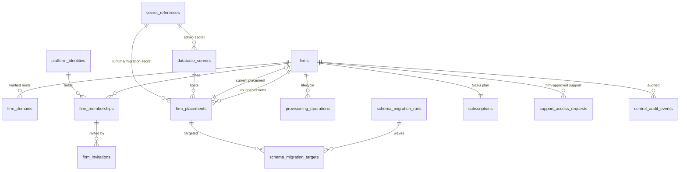
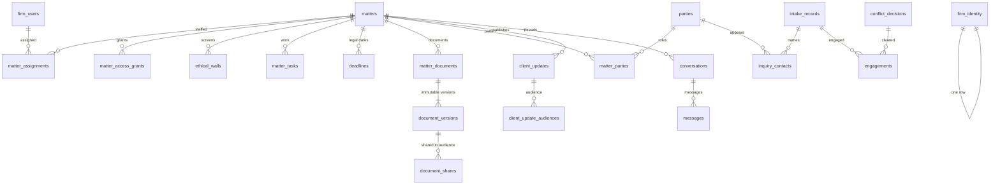
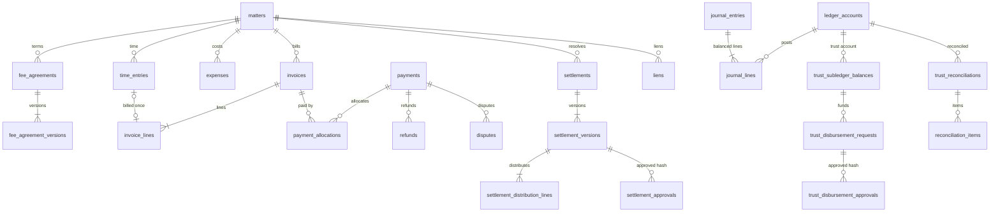

# Logical model and data dictionary (multi-firm design)

[Home](../README.md) · [Database](README.md) · [ADR-002](ADR-002-multitenant-architecture.md) · [Logical model (original)](data-model.md) · [Query and index spec](query-and-index-spec.md) · [SQL artifacts](../../db/design/README.md)

**Status:** design. The authoritative column-level definitions are the reviewable DDL files in [`db/design/`](../../db/design/README.md). This page explains ownership, decisions, sensitivity, retention, and growth. Only the 18 tables marked **existing** are implemented, through the EF migrations `Baseline` and `MatterAccessGrants`. Everything else is designed but not implemented.

## Cross-cutting decisions

| Topic | Decision | Reason and validation |
|---|---|---|
| Entity ids | `char(36) COLLATE ascii_general_ci` GUIDs, generated by the application | Matches the existing EF/Pomelo mapping. Ids can be created before insert and carried through imports. Ids never confer access |
| High-volume append-only ids | `bigint AUTO_INCREMENT` clustered key plus a `PublicId char(36)` where the row is addressable (messages, custody events, journal lines, outbox, control audit) | Appends to the end of the B-tree and gives cheap keyset pagination (Q4c). Values overlap across firm databases by design; this was validated with deliberately overlapping ids (G13) |
| Collation of id columns | Every id column and every FK that references one uses `ascii_general_ci` | A mismatched FK fails with ERROR 3780 (E10). Comparing with a utf8mb4 value converts the column side and drops its index (Q0 table scan versus Q0b index lookup). Hand-written SQL must bind GUIDs as ascii |
| Money | `DECIMAL(19,2)` amounts plus `CurrencyCode char(3)`, constrained to `'USD'` until multi-currency is designed. Rates `DECIMAL(19,4)`; quantities `DECIMAL(12,4)` | Exact arithmetic. Line amounts are rounded to cents at the line with MySQL `ROUND` on exact DECIMAL (half away from zero); totals are sums of rounded lines. CHECKs enforce `Amount = ROUND(rate × minutes / 60, 2)` (L13). Whether the firm uses another rounding rule is an open question |
| Instants | `datetime(6)`, UTC, columns named `*AtUtc` | Matches the existing schema. The client converts to the firm's time zone |
| Legal and accounting dates | `DATE`, plus `TimeZone` (IANA) and `Jurisdiction` where the meaning depends on them | A filing deadline is a calendar date in a court's jurisdiction, not an instant |
| Concurrency | `RowVersion int`, incremented by the application on update, for mutable aggregates (permissions, invoices, settlements, approvals, placements, operations) | EF optimistic concurrency token |
| Money movement | Row locks (`SELECT … FOR UPDATE`) inside one transaction, CHECK constraints for invariants, and triggers for cross-row ledger rules | A concurrent overdraft was rejected (R2). A post racing an extra line was rejected (R1) |
| Approvals | Version-bound by a composite FK `(Id, ContentSha256)` to the exact approved version | A wrong-hash approval fails with 1452 (L11). Changing approved content fails with 1451 (L12) |
| Soft "active" uniqueness | A nullable STORED generated `ActiveMarker` inside a UNIQUE index | Allows many ended rows but only one active row (E12, E12b). This is the existing grant pattern |
| Enumerations | `varchar` plus CHECK | Readable in dumps, diffable, and enforced since 8.0.16 (E11) |
| Deletion | `ON DELETE RESTRICT` for anything with legal or financial meaning; `CASCADE` only for pure children (aliases, notes, audiences) | Matters, documents, and ledger rows must not disappear as a side effect |

## Tenant columns in firm databases
**Not added.** A firm database holds one firm, so a `FirmId` on every row would be a constant the database can't use to reject anything. It would add width to every index and cost a migration on every existing table.

Ownership is instead asserted by `firm_identity`, which holds exactly one row (CHECK on `Singleton = 1`) and which the runtime account can read but not write (G8). It is also asserted by the out-of-database artifacts listed in [ADR-002](ADR-002-multitenant-architecture.md) §9. The cost of reversing this choice is recorded there.

**Firm identity verification and its limits.** After opening each connection lease (an EF `DbConnectionInterceptor`), the application reads `firm_identity` and compares `FirmId` and `PlacementRoutingVersion` with the resolved placement. On mismatch it closes the connection and fails the request with no fallback.

This catches a wrong database name or a wrong secret in the catalog, and a database left behind by an old routing version. It does **not**:
- authorize anything inside the firm;
- detect a compromised application process;
- prevent a restored copy from claiming the same identity (the routing version only narrows that);
- prove that the grants are correct. Only the grant tests (G1–G15) show that.

## Existing tables mapped to the target

| Existing table | Owner module | Target | Change needed | Migration risk |
|---|---|---|---|---|
| `matters` | Matters | Firm DB, unchanged core | Add indexes `(Status, CreatedAtUtc, Id)` and `ParalegalActorId`. Later, an expand/contract move of assignment columns into `matter_assignments`; `MatterNumber` from `matter_number_sequences` | Index builds are INPLACE (E8). Max+1 numbering races until sequences exist |
| `matter_access_grants` | Access | Firm DB | None; it already has the ActiveMarker pattern | Low |
| `matter_tasks` | Matters | Firm DB | Add `(MatterRecordId, Status, DueAtUtc)` and `(AssigneeActorId, Status, DueAtUtc)`. The old single-column `IX_matter_tasks_MatterRecordId` becomes redundant and is dropped in a contract step | Write amplification from the extra indexes (about 51 MB of indexes on 22 MB of data in the fixture) |
| `matter_documents` | Documents | Firm DB, becomes the logical document | Add `(MatterRecordId, UploadedAtUtc, Id)`. `StorageKey` becomes legacy once `document_versions` exist (expand → backfill version 1 → switch reads → contract) | Backfill must preserve upload metadata |
| `matter_stage_history`, `intake_stage_history` | Matters, Intake | Firm DB, append-only by grant | None | Low |
| `matter_timeline_actions` | Matters | Firm DB | None | Low |
| `parties`, `party_aliases`, `party_relationships` | People | Firm DB; contacts and organizations | Link to matters through `matter_parties`, and to inquiries through `inquiry_contacts` | Party merge logic must re-point new FKs |
| `intake_records`, `intake_notes` | Intake | Firm DB | `(Stage, NextActionDueAtUtc, Id)` | Low |
| `conflict_checks`, `conflict_decisions` | Conflicts | Firm DB | Referenced by `engagements` | Low |
| `consultation_requests` | Intake | Firm DB | `(Status, PreferredAtUtc, Id)` (Q7b) | Low |
| `calendar_entries` | Calendar | Firm DB | `MatterReference` is a free-text reference. It needs a later expand/contract to a `MatterRecordId` FK. `deadlines.CalendarEntryId` links legal deadlines to it | A text-to-FK backfill can fail on unmatched references, so a reconciliation report is needed |
| `audit_events` | Audit | Firm DB, append-only by grant (G7) | Add `(ObjectType, ObjectId, OccurredAtUtc)` | Same-transaction audit (G16 in the gap map) is still open |
| `__EFMigrationsHistory` | Platform | Firm DB, SELECT-only for runtime | Version checked against `firm_placements.SchemaVersion` | Drift detection relies on it |

**Ordinary domain tables:** `matters`, `invoice_lines`, and `inquiry_contacts` are ordinary firm tables with single-column FKs and no tenant columns. Firm scope comes from the database they live in.

## ERD: control plane

## ERD: firm database (core and required additions)

## ERD: firm database (money)

## Control-plane tables
All of these are in [01-control-plane.sql](../../db/design/01-control-plane.sql). None of them hold client legal content.

| Table | Purpose | Key constraints | Sensitive fields | Retention and deletion | Growth |
|---|---|---|---|---|---|
| `firms` | Firm and lifecycle (`Provisioning…Retired`) | Unique slug matching a DNS-label pattern; FK to the current placement | Legal name (business data) | Kept after offboarding as `Retired` for contract evidence | One per firm |
| `firm_domains` | Hosts that resolve a firm | `Host` unique; `Verified` requires `VerifiedAtUtc` | Verification token **hash** only | Revoked rows kept for audit | A few per firm |
| `platform_identities` | Issuer and subject reference | Unique `(Issuer, Subject)`; `SessionEpoch` revokes all sessions | Subject id | Disabled, not deleted, while memberships reference it | One per person |
| `firm_memberships` | Identity in a firm, with `MembershipVersion` | Unique `(FirmId, IdentityId)` | — | Revoked rows kept | Staff plus clients per firm |
| `firm_invitations` | Single-use invite | Unique `TokenHash` | `EmailNormalized`, set to NULL after acceptance or expiry | Purge after expiry plus a grace period | Transient |
| `secret_references` | Pointers into the secret store | Unique `(Provider, ExternalRef)` | None (no values) | Retired, not deleted | A few per firm |
| `database_servers` | Cells | `ConnectionBudget < MaxConnections` | Endpoint reference | Closed, not deleted | Tens |
| `firm_placements` | Firm database location, by routing version | Unique `(FirmId, RoutingVersion)` and `(ServerId, DatabaseName)`; name pattern check | — | Old versions retained (`Retired`) | One per move |
| `provisioning_operations` | Idempotent lifecycle operations with leases | Unique `(OperationType, IdempotencyKey)` | Error **codes** only | Retained | A few per firm |
| `schema_migration_runs`, `schema_migration_targets` | Fleet rollout | Composite PK `(RunId, PlacementId)` | — | Retained | Releases × firms |
| `subscriptions`, `platform_webhook_receipts` | SaaS billing with the firm | Unique provider references | Provider customer reference | Per finance policy | Low |
| `support_access_requests` | Firm-approved support entry | Approver ≠ requester; approval needs an expiry | `Reason` must not contain client facts | Retained | Low |
| `control_audit_events` | Control-plane audit, append-only | bigint PK | Codes and ids only | Retained per policy | Grows with operations |

## Firm data plane

### Required now (prerequisites for the first tenancy steps)
These are in [11-firm-schema-required.sql](../../db/design/11-firm-schema-required.sql).

| Table | Purpose | Concurrency | Sensitive | Retention and deletion | Growth (per firm) |
|---|---|---|---|---|---|
| `firm_identity` | Ownership assertion | Written once by provisioning | — | Lives with the database | 1 row |
| `firm_users` | Firm-local directory keyed by `ActorId`, the key used by every existing `*ActorId` column | RowVersion | Display names | Deactivated, not deleted | Staff + clients |
| `matter_number_sequences` | Race-free numbering with `FOR UPDATE` | Row lock | — | — | 1 row per year |
| `matter_assignments` | Staff role on a matter (expand step) | One active row per (matter, actor, role) via ActiveMarker | — | Ended rows kept | 2–3 per matter |
| `ethical_walls` | Screens an actor even when a role or grant would allow access | One active wall per (matter, actor) | Reason | Lifted rows kept | Rare |
| `outbox_events` | Transactional outbox; identifiers only in the payload | Lease plus `SKIP LOCKED` (R3) | Must not contain narratives | `Done` rows archived after N days | High: about 1 per write |
| `webhook_receipts` | Provider event dedup scoped by provider **account** | Unique `(Provider, ProviderAccountRef, EventId)` (L15, L16); CHECK that the signature was verified (L17) | Payload hash only | Per finance policy | Per provider event |

### Future (introduced by the step that needs it)
These are in [12-firm-schema-future.sql](../../db/design/12-firm-schema-future.sql) and [13-firm-ledger-triggers.sql](../../db/design/13-firm-ledger-triggers.sql).

| Domain | Tables | Notable rules |
|---|---|---|
| People and intake | `matter_parties`, `inquiry_contacts`, `engagements` | Party roles enumerated; engagement requires a conflict decision; signed requires `SignedAtUtc` |
| Deadlines | `deadlines` | DATE plus jurisdiction plus rule reference; non-unverified states need a verifier |
| Publication | `client_updates`, `client_update_audiences` | Published requires an approver; the audience is explicit rows, never a bare visibility flag |
| Messaging | `conversations`, `conversation_participants`, `messages` | bigint message ids; keyset index `(ConversationId, Id)` |
| Documents and evidence | `document_versions` (immutable by grant), `document_shares`, `preservation_holds`, `evidence_items`, `custody_events` (append-only, hash-chained) | Shares point at an exact version. Holds block deletion through RESTRICT FKs and the purge workflow |
| Billing | `fee_agreements`, `fee_agreement_versions`, `time_entries`, `expenses`, `invoices`, `invoice_lines` | Time billed once (`UNIQUE SourceTimeEntryId`, L14); amount checks; `BalanceDue` and `OpenMarker` generated columns |
| Payments | `ledger_accounts`, `payments`, `payment_allocations`, `refunds`, `disputes` | Allocated plus refunded never exceeds the amount (L18); provider references unique per merchant account |
| Ledger and trust | `journal_entries`, `journal_lines`, `trust_subledger_balances`, `trust_reconciliations`, `reconciliation_items`, `trust_disbursement_requests`, `trust_disbursement_approvals` | Triggers: balanced posting (L2), posted rows immutable (L3–L6), at least 2 lines (L7). Idempotency key (L8). Non-negative trust subledger (L9, R2). Three-way reconciliation check; approver ≠ preparer |
| Settlement (PI) | `liens`, `settlements`, `settlement_versions`, `settlement_distribution_lines`, `settlement_approvals` | Version-bound approvals by content hash |
| Reliability | `import_batches`, `import_row_mappings` | Re-import is idempotent through the source-key map |
| Construction | `construction_projects`, `construction_contracts`, `change_orders`, `construction_notices` | Notices link to deadlines |
| Personal injury | `pi_incidents`, `insurance_policies`, `treatment_episodes`, `medical_record_requests`, `damage_items` | `treatment_episodes.Summary` is health information: it requires a restricted permission and is never logged, indexed for search snippets, or put in notifications |

**Sensitive classes.**
- **Privileged:** narratives (time entries, messages, client updates, notes).
- **Health:** treatment, medical requests.
- **Financial identifiers:** policy and claim numbers, bank references. Store references, never full account numbers.
- **Contact data:** parties, consultation requests.

None of these may appear in the control plane, logs, outbox payloads, cache keys, or object keys.

**Retention.** Matter-scoped records follow the firm's retention schedule (an open decision) and preservation holds. Posted financial records are corrected by reversal, never by deletion. Deletion at offboarding is `DROP DATABASE` plus object-prefix deletion, with evidence recorded in the [recovery and offboarding runbook](../operations/recovery-and-offboarding-runbook.md).

**Expected growth drivers**, from the synthetic fixture's relative sizes: messages, outbox, audit, and tasks dominate the row count. Document binaries, which live outside the database, will dominate storage.
