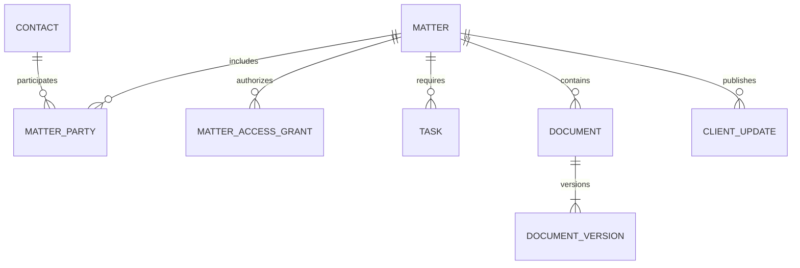

# Logical data model and invariants

[Home](../README.md) · [Database](README.md) · [Ledger](../billing/payments-and-ledger.md)

This is a logical model, not runnable migrations. Cursor must translate it into the audited engine and ORM and document actual columns, indexes, deletes, and constraints.

## Control plane
Tenant(id, name, status, region, placement_id); TenantDomain(host, tenant_id, verified_at); Identity(id, authentication_subject); Membership(identity_id, tenant_id, status, role_reference); Subscription(tenant_id, plan, provider_customer_ref, status); DatabasePlacement(id, engine, endpoint_reference, secret_reference, schema_version); ProvisioningJob(tenant_id, operation_key, state).

Global identity records are deliberately minimal. Client contacts, narratives, medical records, messages, and case documents belong to the firm data plane. Membership removal must promptly invalidate sessions and jobs that rely on old privileges.

## Firm data plane

| Domain | Main entities | Key relationships |
|---|---|---|
| People | Contact, Organization, ContactRelationship, FirmUser | People and organizations can occupy multiple roles |
| Intake | Inquiry, IntakeSubmission, FormVersion, ConflictReview, Consultation, Engagement | Inquiry does not imply engagement; conflict decisions reference reviewed parties |
| Matter | Matter, MatterParty, MatterAssignment, MatterAccessGrant, PhaseHistory | Many clients/parties per matter; explicit roles and grants |
| Work | Task, Deadline, CalendarEvent, WorkflowTemplateVersion | Matter owns work; deadlines reference source and reviewer |
| Publication | ClientUpdate, PublicationAudience, PublicationHistory | Published audience and author/approver are explicit |
| Messaging | Conversation, Participant, Message, Attachment | Participants are authorized, scoped, and revocable |
| Documents | Document, DocumentVersion, DocumentAccessGrant, SignatureEnvelope | Metadata references immutable private object versions |
| Evidence | EvidenceItem, CustodyEvent, PreservationHold, ProductionSet | Originals preserved; productions reference exact versions |
| Billing | FeeAgreementVersion, TimeEntry, Expense, Invoice, InvoiceLine, CreditMemo | Invoice captures rate/agreement snapshots, not mutable lookups |
| Money | Payment, PaymentAllocation, Refund, Dispute, BankAccount, JournalEntry, JournalLine | Payments and ledger entries related but not interchangeable |
| Trust | TrustSubledger, Reconciliation, ReconciliationItem, DisbursementApproval | Balances by beneficiary/matter/account; approvals versioned |
| Settlement | SettlementVersion, Lien, DistributionLine, DistributionApproval | Approved calculations and authority tied to exact version |
| Reliability | AuditEvent, OutboxEvent, WebhookReceipt, ImportBatch | Durable traceability and deduplication |

## Matter core diagram

## Enforce these invariants
Use stable IDs; UUIDs are useful for portability but never confer authorization. Firm-owned records carry tenant ownership even in a dedicated database. Enforce same-firm references through composite keys/foreign keys where supported; otherwise document equivalent engine enforcement, not just application checks. For a pooled alternative, unique(tenant_id,id) plus foreign key(tenant_id,matter_id) → Matter(tenant_id,id) prevents cross-tenant references.

Uniqueness of a matter number is firm scoped. Provider event IDs are unique within provider/account scope. Journal postings balance by currency and entry; use a posting transaction or controlled procedure because a row-level check cannot prove sums across all lines. Posted financial records are corrected with reversals, not edits or soft deletion.

Require concurrency tokens for settlements, permissions, invoices, and approval decisions. Changing an approved settlement invalidates its approval. Required publication fields include state, audience, exact source/version references, approver, and timestamps. Avoid an unrestricted is_visible flag as the whole access model.

Indexes follow actual access paths: matter(status, responsible_user_id, updated_at), task(matter_id,state,due_at), deadline(due_date,state), document(matter_id,classification), message(conversation_id,created_at), invoice(matter_id,status), and ledger(account_id,effective_at). Add tenant prefixes for pooled storage. Validate plans and pagination; these are candidates, not prescriptions for every engine.

PI extension entities include Incident, CoveragePolicy, TreatmentEpisode, MedicalRecordRequest, DamageItem, and Lien. Construction extensions include Project, Contract, ChangeOrder, ProjectParticipant, Claim, Notice, Defect, and Inspection. Keep core entities typed; version configurable questionnaires separately.
