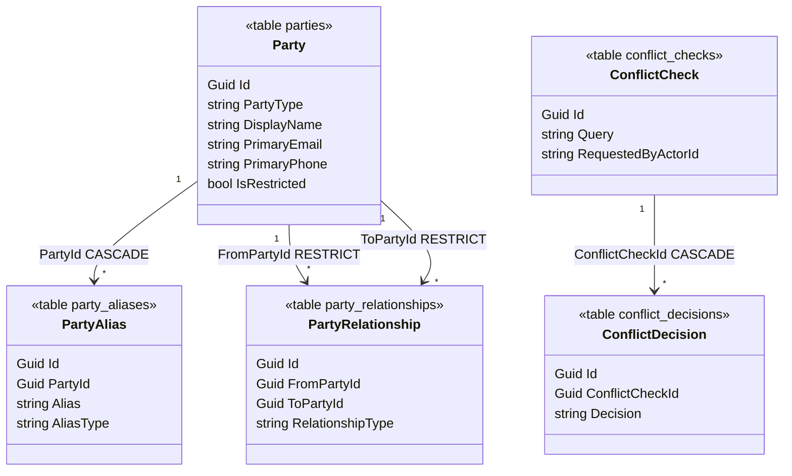
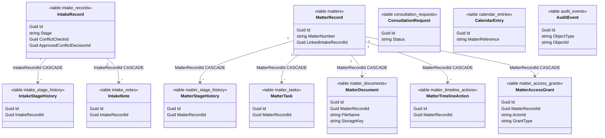
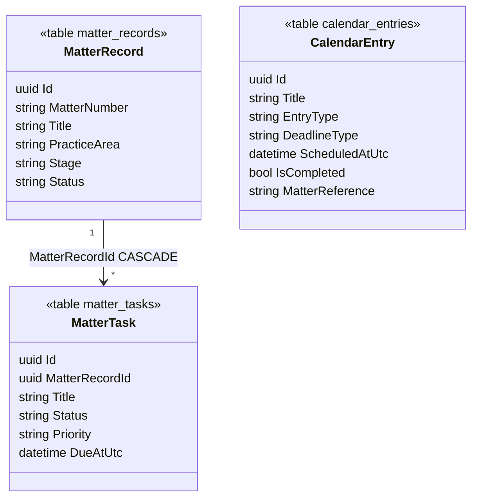
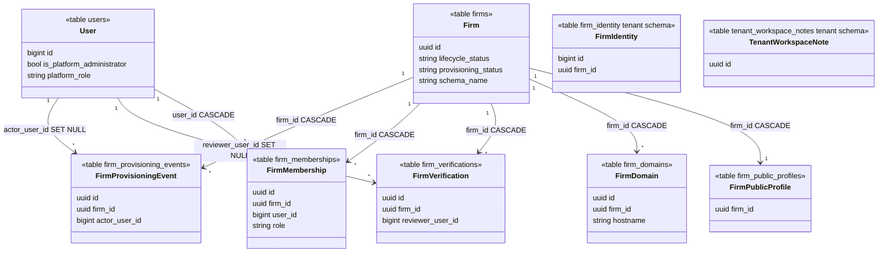
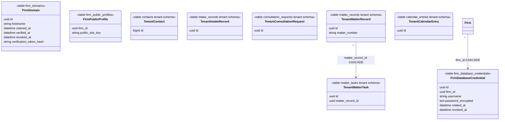
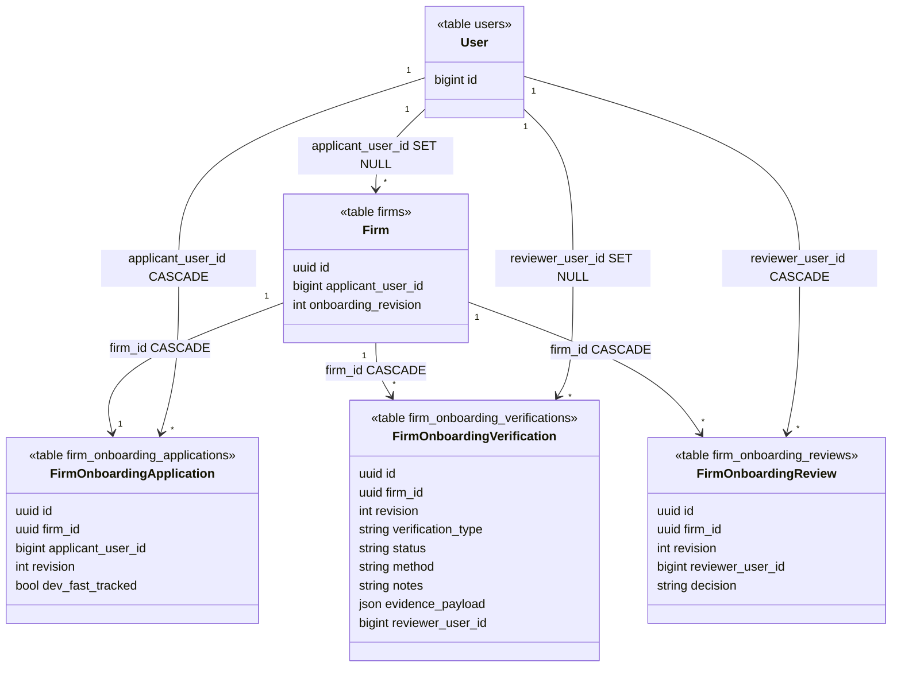

# UML class diagrams

[Database](README.md) · [Schema evolution](schema-evolution.md) · [ERD and data dictionary](data-dictionary.md) · [EF model](../../backend/Infrastructure/Persistence/LawFirmDbContext.cs)

Developers use a UML class diagram to design a relational schema: a class becomes a table, an attribute becomes a column, and an association becomes a foreign key. This file is that map for the **applied** MySQL schema. The entity-relationship diagrams in the [data dictionary](data-dictionary.md) are the **designed** multi-firm model, including tables that are not created yet. When the two disagree, the class diagram plus [schema evolution](schema-evolution.md) describe the database the application uses.

## Mapping rules used here

| UML | Relational | In this codebase |
|---|---|---|
| Class | Table | EF `ToTable` on the class in `LawFirmDbContext` |
| Attribute | Column | The property name is the column name unless EF is told otherwise |
| Association, one to many | Foreign key on the many side | `HasForeignKey` in `LawFirmDbContext` |
| Association, many to many | A class of its own | `PartyRelationship` is a table with two foreign keys, not a hidden join |
| Composition, cascade delete | `ON DELETE CASCADE` | Marked on the association |
| Aggregation that must survive | `ON DELETE RESTRICT` | Party relationships |
| Attribute with no association | A column that is not a foreign key | Listed under "Not associations" in the schema evolution file |

Identifiers are `char(36)` GUIDs. Instants are `datetime(6)` UTC. The diagrams show the attributes that identify the row and the association. The full column list is the EF configuration, not a second copy kept here.

## People and conflicts

`Party` is the stored contact. The signed-in screen calls it a Contact (decision D-20261013-1). There is no second contacts table.

## Intake, matters, calendar, audit

`ConsultationRequest`, `CalendarEntry`, and `AuditEvent` have no foreign key to another class. `IntakeRecord.ConflictCheckId`, `IntakeRecord.ApprovedConflictDecisionId`, and `MatterRecord.LinkedIntakeRecordId` are attributes only. `CalendarEntry.MatterReference` is text. Drawing those as associations would claim a constraint MySQL does not have. See [schema evolution](schema-evolution.md).

`MatterDocument` is metadata. The class has no version collection and no binary. That matches gap G32.

## When this file changes

Update it in the same change as the EF migration, then add a row to [schema evolution](schema-evolution.md). Do not paste the future billing or trust classes here until a migration creates their tables. Those designed tables stay on the ERD.

## Laravel migration stack snapshot (2026-10-18)

The active migration stack in this repository is Laravel. The following class diagram captures the newly added workspace-parity entities implemented in this session:

## Laravel control plane and tenant schema (2026-10-19)

Applied by the migrations in [schema evolution](schema-evolution.md) rows L4–L7. `firm_identity` and `tenant_workspace_notes` are created in each firm schema, not in the control-plane database.

`FirmIdentity.firm_id` matches `Firm.id` in application code after the connection opens. It is not a database foreign key across schemas.

## Laravel control-plane and tenant additions (2026-10-20)

Applied by schema-evolution rows L8-L15.

## Laravel onboarding control-plane additions (2026-10-22 and 2026-10-23)

Applied by schema-evolution row L16.

